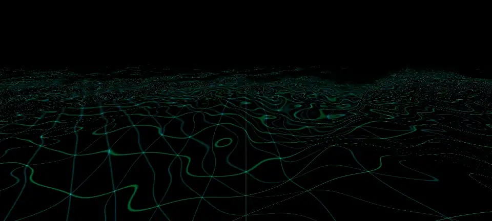

# PSOrvia Klangozean

[](https://h-peterseim.github.io/klangozean/demo.html)

**Skaņai reaģējošs režģa okeāns tavai vietnei**

### ▶ [Tiešraides demo ar mūziku](https://h-peterseim.github.io/klangozean/demo.html)

Mierīgs perspektīvas režģis kā lapas fons. Tas reaģē uz jebkuru lapas skaņu un video un aiz tava teksta izdziest.

## Iekļaušana

```html
<script src="klangozean.js"></script>
<klang-ozean></klang-ozean>
```

```html
<script type="module" src="klangozean.esm.js"></script>
```

## Atribūti

| Attribute | Default | |
|---|---|---|
| `color-a, color-b` | `#3ddc84, #40ccff` | Līniju krāsas, tumšā tēma |
| `color-a-light, color-b-light` | `#0a6b38, #0d5c85` | Līniju krāsas, gaišā tēma |
| `density` | `1 (0.3-3)` | Režģa blīvums |
| `line-width` | `0.7 (0.3-3)` | Līnijas biezums |
| `opacity` | `1 (0-1)` | Necaurredzamība |
| `reactivity` | `1 (0-3)` | Reakcijas stiprums |
| `horizon` | `0.64 (0.2-0.9)` | Horizonta augstums |
| `audio` | `audio, video` | Skaņas avots (CSS selektors) |
| `fade-text` | `h1, h2, h3, p, li` | Izdzišana aiz teksta (selektors vai off) |
| `max-fps` | `30` | Kadru ātruma ierobežojums |

Darbojas pašreizējos Chrome, Edge un Firefox ar WebGL. Bez WebGL iegūsi mierīgu pāreju, ar samazinātu kustību nekustīgu attēlu.

PSOrvia Klangozean darbojas kā vietnes [psorvia.io](https://psorvia.io) fons. Demonstrācijas lapa: **[h-peterseim.github.io/klangozean/demo.html](https://h-peterseim.github.io/klangozean/demo.html)**

## Savas krāsas un savs skaņas avots

Iestati krāsas kā atribūtus un pievieno mikrofonu ar `useAnalyser` (palaid to ar klikšķi):

```html
<klang-ozean id="ocean" color-a="#ff7a59" color-b="#ffd166"></klang-ozean>
<script>
document.querySelector('button').addEventListener('click', async () => {
  const stream = await navigator.mediaDevices.getUserMedia({ audio: true });
  const ctx = new AudioContext();
  const analyser = ctx.createAnalyser();
  ctx.createMediaStreamSource(stream).connect(analyser);
  document.getElementById('ocean').useAnalyser(analyser);
});
</script>
```

## Pieejamība

Ar samazinātu kustību režģis tiek zīmēts kā statisks attēls. Aiz virsrakstiem un teksta tas izdziest (`fade-text`), tāpēc viss paliek salasāms.

## Veiktspēja

Kadru nomaiņas ātrums ir ierobežots (`max-fps`), zīmēšana apstājas slēptās cilnēs un tiek ierobežota mobilajās ierīcēs. Skripts ir apmēram 15 KB, apmēram 6 KB ar gzip, bez atkarībām.

## Tulkojumi

[English](../../README.md) · [Deutsch](README.de.md) · [Български](README.bg.md) · [Čeština](README.cs.md) · [Dansk](README.da.md) · [Ελληνικά](README.el.md) · [Español](README.es.md) · [Eesti](README.et.md) · [Suomi](README.fi.md) · [Français](README.fr.md) · [Gaeilge](README.ga.md) · [Hrvatski](README.hr.md) · [Magyar](README.hu.md) · [Italiano](README.it.md) · [Lietuvių](README.lt.md) · [Latviešu](README.lv.md) · [Malti](README.mt.md) · [Nederlands](README.nl.md) · [Polski](README.pl.md) · [Português](README.pt.md) · [Română](README.ro.md) · [Slovenčina](README.sk.md) · [Slovenščina](README.sl.md) · [Svenska](README.sv.md)

## Licence

Kods ir ar MIT licenci (skat. [LICENSE](../../LICENSE)). Demonstrācijas mūzikas failam būs sava licence: [CC BY 4.0](https://creativecommons.org/licenses/by/4.0/), Petit Souris / psorvia.io ([media/LICENSE.md](../../media/LICENSE.md)).

SPDX-License-Identifier: MIT

Built for [psorvia.io](https://psorvia.io).
